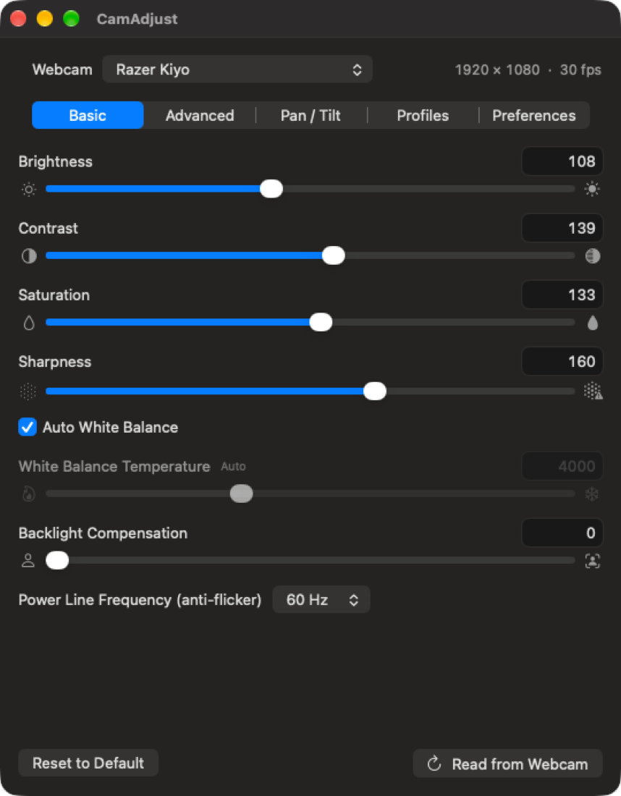
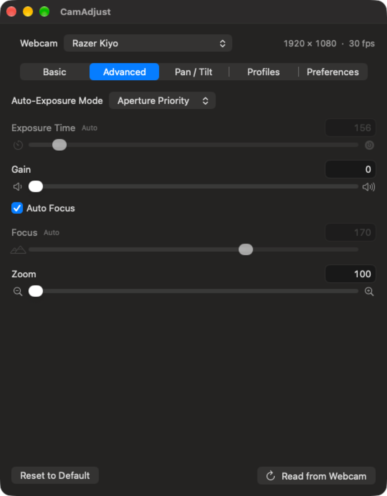
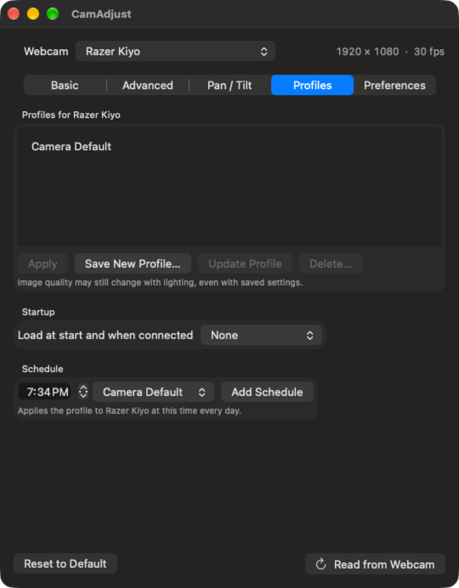
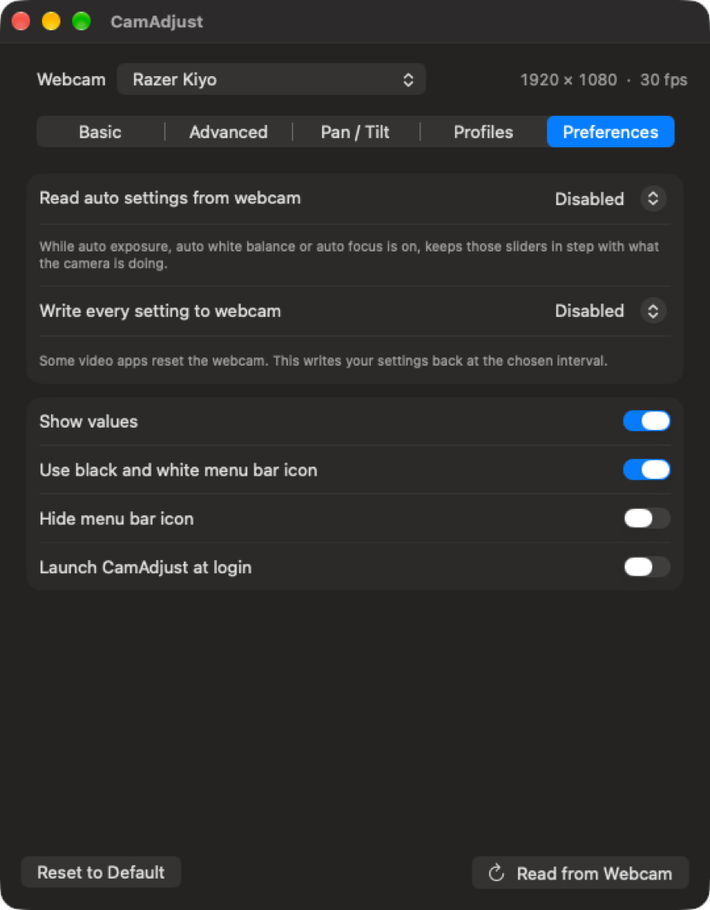

# CamAdjust

**The webcam controls macOS doesn't give you.** CamAdjust is a menu bar app
for USB (UVC) webcams: brightness, exposure, focus, white balance, zoom,
pan/tilt and more, with named profiles, daily schedules, and automatic
re-application when other apps or sleep reset your camera.

Native Swift, universal binary (Apple Silicon + Intel), macOS 13 or later.

| Basic | Advanced |
|---|---|
|  |  |
| **Profiles and schedules** | **Preferences** |
|  |  |

CamAdjust is an independent, from-scratch replacement for the x86_64-only
Webcam Settings 3.0, with at least the same features. See
[docs/ORIGINAL_ANALYSIS.md](docs/ORIGINAL_ANALYSIS.md) for how that app's
behavior was studied; no code or assets from it are used.

## Requirements

- macOS 13 or later, Apple Silicon or Intel
- Xcode Command Line Tools (`xcode-select --install`)

## Build

    ./build.sh

The app is written to `build/CamAdjust.app`. Move it to `/Applications`
and open it. The panel opens on first launch; after that, use the camera
icon in the menu bar.

## Features

| Feature | Webcam Settings 3.0 | CamAdjust |
|---|---|---|
| Brightness, contrast, hue, saturation, sharpness, gamma, backlight, gain | Yes | Yes |
| White balance temperature + auto | Yes | Yes |
| White balance U/V + auto | Yes | Yes |
| Hue auto | No | Yes |
| Power line frequency (Disabled / 50 / 60 / Auto) | Yes | Yes, limited to what the camera supports |
| Auto-exposure mode (Manual / Auto / Shutter / Aperture priority) | Yes | Yes, limited to the camera's supported modes |
| Exposure time, focus + auto focus, zoom | Yes | Yes |
| Aperture (iris) | Relative −/+ | Relative −/+ and absolute slider |
| Pan / tilt | Yes | Absolute sliders; Logitech motor −/+ pad and reset |
| Logitech LED (Auto / On / Off) | Yes | Yes, same model list |
| Exposure "knob" cameras (LifeCam, Creative, HP) | Yes | Yes |
| LifeCam Studio stepped zoom | Yes | Yes |
| Sliders with −/+ step buttons and value field | Yes | Yes, stepped by the camera's resolution |
| Controls greyed out while their auto mode is on | Partly | Yes |
| Video format and FPS | Yes | Yes |
| Named profiles per camera, Camera Default, save/update/delete | Yes | Yes |
| Load profile at start | Yes | Yes, also when the camera is plugged in |
| Daily profile schedules | Yes | Yes, with per-schedule on/off |
| Read auto values interval | Yes | Yes |
| Write settings back interval (for apps that reset the camera) | Yes | Yes |
| Re-apply after sleep/wake | Restarts timers | Restarts timers and rewrites settings |
| USB hot-plug | Yes | Yes |
| Apply profiles and set the LED from the menu bar | No | Yes |
| Colour or black-and-white icon, hide icon, launch at login | Yes | Yes |
| Noise reduction (CoreMediaIO, Apple built-in cameras only) | Yes | No, see below |
| Licence, purchase and update check | Yes | Not needed |

## How it talks to the camera

UVC requests go through each camera's VideoControl interface (class 14,
subclass 1) using the IOKit `IOUSBInterfaceInterface` user client. The
interface is never opened, so this works while macOS's UVC driver is using
the camera. If a camera stops responding, the app wakes it and retries once.

Tested on macOS 27 with a Razer Kiyo and the Apple Thunderbolt Display
FaceTime HD camera: controls are discovered, profiles, Camera Default and
write-back restore values correctly, and schedules compute the right times.

Not tested on hardware: Logitech LED and motor commands, exposure-knob and
LifeCam quirks (no such cameras were available), USB hot-plug, and
sleep/wake.

## Not included

- **Noise reduction.** The original reached this through CoreMediaIO, only
  for Apple's built-in (non-USB) cameras. Current macOS no longer exposes
  those controls for built-in cameras.

## Tips

- If the menu bar icon is hidden, open CamAdjust again from Finder or
  Spotlight to show the panel.
- `open build/CamAdjust.app --args -PanelTab Profiles` opens the panel
  on a given tab.

## Distribution

The build is ad-hoc signed and not notarized, so it runs on the Mac that
built it. To share it, sign with a Developer ID certificate and notarize
with `notarytool`.
